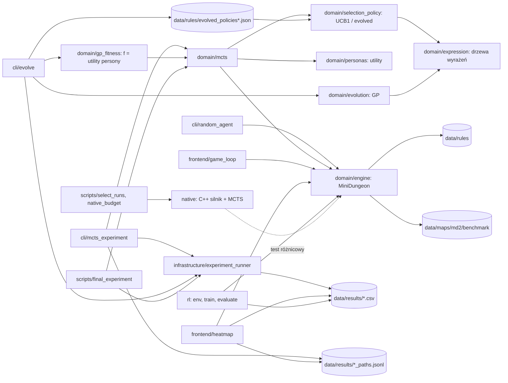

# MiniDungeons MCTS

Deterministyczna rekonstrukcja MiniDungeons 2 przygotowana jako środowisko do
testowania agentów i implementacji Monte Carlo Tree Search. Etap map i zasad
jest zamrożony; modułem badawczym jest MCTS.

## Jak działa program

1. `MiniDungeon` czyta plik mapy oraz reguły z JSON i buduje stan początkowy.
2. `MiniDungeon.step()` wykonuje akcję bohatera, a potem deterministyczne tury NPC.
3. Stan udostępnia `legal_actions()`, `clone()`, `state_key()` i metryki gry.
4. `MonteCarloTreeSearch` buduje drzewo na klonach stanu, a liście ocenia
   funkcją użyteczności wybranej persony. Kryterium zejścia dostarcza
   `domain/selection_policy` — UCB1 albo formuła wyewoluowana przez GP.
5. `cli/mcts_experiment` definiuje pojedynczą próbę, a `experiment_runner`
   rozdziela je na procesy i zapisuje wznawialny CSV. Obowiązujące wyniki liczy
   `scripts/final_experiment.py` — ten sam protokół z jawnymi konwencjami pomiaru.
6. `rl/` opakowuje ten sam silnik w środowisko Gymnasium dla PPO, a `native/`
   to port silnika i MCTS do C++ (×58) dla przebiegów budżetowanych iteracjami.



Agent MCTS tworzy `MiniDungeon` bezpośrednio ze ścieżki do pliku mapy — między
algorytmem a domeną nie ma warstwy serwisowej ani repozytorium.

### Granice warstw

| Warstwa | Odpowiedzialność | Nie zna |
| --- | --- | --- |
| `domain/engine` | stan, akcje, NPC, reguły, metryki | person, MCTS, wejścia-wyjścia |
| `domain/personas` | funkcje użyteczności czterech person | drzewa MCTS |
| `domain/mcts` | węzeł, UCB1, selekcja, ekspansja, rollout, propagacja | CSV, procesów, argumentów CLI |
| `infrastructure` | kanoniczne ścieżki, ślady partii, wznawialny CSV i pula procesów | przebiegu tury, person, tree policy |
| `cli` | argumenty, definicja pojedynczej próby, formatowanie tabel | logiki potworów |
| `frontend` | rysowanie planszy, ręczna rozgrywka, heatmapy, odtwarzacz partii | reguł gry — akcje bierze z `legal_actions()` |
| `rl` | środowisko Gymnasium, trening i ocena PPO, generator map | MCTS i person poza funkcją użyteczności |

Zależności biegną do środka: `cli` woła `domain`, a `domain/mcts` woła
`domain/engine`. Silnik nie wie o istnieniu MCTS. Ewentualny adapter (np.
wizualizację) dopisuje się obok domeny, nie pod agentem.

## Jak czytać kod MCTS

Cały algorytm to jedna pętla w `MonteCarloTreeSearch._iterate()`. Reszta
`domain/mcts.py` to dwa protokoły zbudowane na tej pętli, różniące się wyłącznie
warunkiem stopu.

Jedna iteracja, w kolejności:

1. Selekcja — schodź w dół, póki węzeł jest w pełni rozwinięty:
   `node.best_child(policy)` → `policy.select(node)`. Wybór spośród
   `viable_children()`, czyli dzieci jeszcze niewyczerpanych.
2. Ekspansja — jeśli zostały nieprzetestowane akcje i gra trwa,
   `node.expand(rng)` tworzy jedno losowe dziecko na sklonowanym stanie.
3. Symulacja — `rollout()` gra 10 losowych ruchów na kopii i zwraca
   użyteczność persony (`personas.utility`). Stan węzła zostaje zamrożony.
4. Propagacja — `backpropagate()` dolicza wizytę i użyteczność każdemu
   przodkowi aż do korzenia włącznie i odświeża znacznik wyczerpania.

Dwa protokoły nad tą pętlą:

| Metoda | Budżet | Kiedy kończy | Co zwraca |
| --- | --- | --- | --- |
| `search()` | liczba iteracji | wyczerpanie budżetu albo całego drzewa | jedna akcja o najwyższej średniej użyteczności |
| `play_single_tree()` | czas, iteracje albo oba | pierwszy wygrywający węzeł drzewa albo koniec budżetu | metryki całej odegranej partii |

`play_single_tree` to protokół z artykułu: jedno drzewo na mapę, budowane aż do
znalezienia terminalnego węzła z wyjściem, potem odegranie tej sekwencji.
Zwycięstwo napotkane wyłącznie w rolloucie nie kończy szukania — losowe ruchy
symulacji nie są sekwencją do odegrania. Bez wygranej agent odgrywa sekwencję
awaryjną (`_fallback_sequence()`, tryby `utility` / `mean` / `visits`), a
`from_tree` mówi, który z tych dwóch przypadków zaszedł.

### Pojęcia pomocnicze

`TreeSpec` — tree policy deklaruje trzy rzeczy (`needs_terminals`, `pe_mode`,
`terminal_source`), a `TreeSpec.for_policy()` zbiera je raz przy tworzeniu drzewa.
Dzięki temu `Node` nie zna żadnej konkretnej polityki — dostaje gotową
specyfikację i przekazuje ją dzieciom. UCB1 zostawia wartości domyślne i nie płaci
za zmienne Tabeli I ani czasem, ani pamięcią.

`exhausted` — węzeł wyczerpany to terminalny liść albo węzeł w pełni
rozwinięty, którego wszystkie dzieci są wyczerpane. UCB1 wychodzi z martwej
gałęzi sam, dzięki członowi eksploracyjnemu; ewoluowana formuła (eq. 6–9) nie ma
takiego członu i bez tego znacznika potrafiłaby wybierać ten sam martwy liść
w nieskończoność.

`terminal_source` — zmienne Tabeli I dla ewoluowanej polityki biorą się albo
ze stanu zamrożonego w węźle (`"node"`), albo ze średniej po stanach końcowych
symulacji przechodzących przez węzeł (`"rollout"`, ta sama semantyka co `R`).
Domyślne jest `"rollout"`; uzasadnienie w `data/rules/tree_policies.json`.

## Szybki start

Silnik, MCTS i GP nie mają zewnętrznych zależności — wystarczy biblioteka
standardowa. Extras: `gui` (pygame-ce) dla frontendu, `rl` (torch, SB3) dla PPO;
port C++ wymaga `pybind11` i kompilatora C++17.

Losowy agent jako punkt odniesienia:

```powershell
.\.venv\Scripts\python.exe -m src.minidungeons.cli.random_agent --map data\maps\md2\benchmark\map01.txt --trials 10 --quiet
```

Eksperyment MCTS-UCB1 według protokołu Tabeli II z artykułu:

```powershell
.\.venv\Scripts\python.exe -m src.minidungeons.cli.mcts_experiment --trials 50 --time-limit 300 --out data\results\moj_eksperyment.csv
```

Domyślnie liczy wszystkie 11 map i 4 persony; plik wyników wskazuje `--out`.
Eksperyment jest wznawialny: po przerwaniu wystarczy uruchomić identyczną
komendę, a policzone próby zostaną pominięte. `--restart` nadpisuje plik od zera.

## Raport z policzonych wyników

Sama tabela z istniejącego CSV, bez uruchamiania prób:

```powershell
.\.venv\Scripts\python.exe -m src.minidungeons.cli.mcts_experiment --report-only --out data\results\ucb1_bfs.csv
```

Drukuje układ z Tabeli II — Monsters, Potions, Treasures, Interactive Objects,
Win Rate oraz Time — jako średnia ± 95% przedział ufności dla R, MK, TC i C.

## Pomiar z konwencjami — obowiązujące wyniki

Wynik zależy od czterech konwencji (PE w tree policy, PE w użyteczności, IC,
sekwencja awaryjna) i od tego, czy BFS do wyjścia zna portale. Wszystkie pliki
w `data/results/` policzył `scripts/final_experiment.py`, który zapisuje je
w kolumnie `search_policy`. Baseline i ewoluowane GP w tej samej konwencji:

```powershell
.\.venv\Scripts\python.exe scripts\final_experiment.py --tag UCB1_BFS --policy ucb1 --trials 50 --time-limit 300 --pe-mode normalized --utility-pe normalized --ic-mode mean3 --fallback visits --pe-portals off --workers 12 --out data\results\ucb1_bfs.csv
.\.venv\Scripts\python.exe scripts\final_experiment.py --tag OURS_BFS_FIX --policy ours --policies data\rules\evolved_policies_bfs_fix_fitness.json --trials 50 --time-limit 300 --pe-mode normalized --utility-pe normalized --ic-mode mean3 --fallback visits --pe-portals off --workers 12 --out data\results\ours_bfs_fix.csv
```

Formuły GP wybiera `scripts/select_runs.py` (C++, 6 map treningowych × 20
seedów, reguła `core` z artykułu albo `fitness`), a `scripts/native_budget.py`
gra UCB1 lub GP z budżetem iteracji z artykułu (3 mln). Tabelę zbiorczą MCTS
i PPO drukuje `scripts/table_rl_mcts.py`.

## Ewolucja tree policy

Formułę zastępującą UCB1 wyłania programowanie genetyczne, protokołem z sekcji
VI-A artykułu: 4 persony × 3 niezależne uruchomienia × 100 generacji × 100
osobników na 5 wyspach, fitness uśredniany po sześciu mapach treningowych
(1, 2, 3, 4, 7, 10).

```powershell
.\.venv\Scripts\python.exe -m src.minidungeons.cli.evolve --workers 12
```

Fitness osobnika to użyteczność persony na koniec partii (`f_R = U_R`), a nie
osobny wzór. Partia idzie budżetem iteracyjnym, nie czasowym — czas nie jest
odtwarzalny, więc fitness liczony na nim zmieniałby się z obciążeniem maszyny.

Ewolucja jest wznawialna na poziomie uruchomienia (persona × run): ukończone
uruchomienia lądują w pliku `gp_runs*.json` w `data/results/` i po restarcie są
pomijane; przerwane liczy się od pierwszej generacji. Uruchomienia idą wszerz —
najpierw run 0 dla wszystkich person, potem run 1 — żeby przerwanie w połowie
zostawiło komplet person, a nie komplet uruchomień dla połowy person.

Dziennik generacji (`gp_generations*.csv`) ma po wierszu na generację:
`best_fitness`, `mean_fitness`, liczba unikalnych chromosomów, rozmiar i postać
najlepszej formuły.

Zwycięskie formuły przepisuje się do pliku polityk osobnym wywołaniem:

```powershell
.\.venv\Scripts\python.exe -m src.minidungeons.cli.evolve --promote
```

Wybór spośród trzech uruchomień idzie po głównej metryce persony, nie po
fitnessie — tak jak w artykule. Po `--promote` wyewoluowane persony gra się tym
samym eksperymentem co baseline, przełącznikiem `--policy ours`.

Ewolucja na porcie C++ (te same argumenty, ok. 60× szybciej):
`.venv\Scripts\python.exe native\evolve_native.py --workers 12`.

## Port C++ (`native/`)

Silnik MD2, MCTS (UCB1 i formuły GP), parser formuł i fitness w C++, wołane
z Pythona przez pybind11 raz na partię. Budowa i weryfikacja przed użyciem:

```powershell
.\.venv\Scripts\python.exe native\setup.py build_ext --inplace
.\.venv\Scripts\python.exe native\difftest.py
.\.venv\Scripts\python.exe native\bench.py
```

Test różnicowy porównuje z Pythonem generator losowy, stan silnika po każdym
kroku i całe partie akcja w akcję — także `pe_portals=off` i UCB1. Szczegóły
w `native/README.md`. Przebiegi budżetowane czasem (300 s) idą w Pythonie:
szybszy kod dałby tam więcej węzłów, a nie ten sam pomiar szybciej.

## Uczenie ze wzmocnieniem (PPO)

`rl/env.py` to ta sama gra co dla MCTS: nagroda = przyrost użyteczności persony
w konwencji MCTS (+ opcjonalny bonus za wyjście), obserwacja to wycinek 39×39
wokół bohatera, nielegalne akcje maskuje MaskablePPO. Opcje: maska pętli
(`--max-wait`), tarcza przed śmiercią (`--shield`), symetrie map (`--augment`),
mapy z generatora (`--generated`, `rl/mapgen.py`). `model.zip` to punkt
kontrolny z najwyższą użytecznością na mapach treningowych, `--resume` dotrenowuje.

```powershell
.\.venv\Scripts\python.exe -m src.minidungeons.rl.train --persona runner --timesteps 6000000 --shield 2 --generated 0.75 --out data\results\ppo_gen
.\.venv\Scripts\python.exe -m src.minidungeons.rl.evaluate --variant ppo_gen --personas runner --deterministic --out data\results\rl_eval\ppo_gen_argmax_runner.csv
```

Ramiona w `data/results/`: `ppo_ego` (6 map GP + symetrie), `ppo_gen` (mapy
z generatora + 6 map GP), `ppo_gen_lb` (jak `ppo_gen`, bonus 0,25),
`ppo_ego11`, `ppo_ego11_lb` (uczone na wszystkich 11 mapach oceny —
transdukcyjne, nie porównywać wprost z GP). Ocena: 11 map × 50 prób, akcje
próbkowane albo argmax. Ślady partii obejrzy `frontend/replay.py`.

## Ręczna rozgrywka

```powershell
.\.venv\Scripts\python.exe -m src.minidungeons.frontend.game_loop --map data\maps\md2\benchmark\map04.txt
```

WSAD lub strzałki to ruch, klik w potwora z linią wzroku (albo Tab i Enter) to
rzut oszczepem, `R` restartuje partię. Wymaga `pygame-ce`
(`pip install -e .[gui]`).

## Heatmapa odwiedzin

Plansza z ręcznej rozgrywki z nałożoną średnią liczbą wizyt bohatera na kaflu
w przeliczeniu na jedną partię, w jednobarwnej skali czerwieni (wielkość koduje
jasność, nie odcień). Kafle nieodwiedzone zostają szare. Wymaga `pygame-ce`
(`pip install -e .[gui]`).

```powershell
.\.venv\Scripts\python.exe -m src.minidungeons.frontend.heatmap
```

Bez argumentów bierze wszystkie pliki z `data/results/`, które mają obok siebie
ślady partii (`ucb1_bfs.csv` → `ucb1_bfs_paths.jsonl`). Konkretny wybór na start:

```powershell
.\.venv\Scripts\python.exe -m src.minidungeons.frontend.heatmap --results data\results\ucb1_bfs.csv --map map04 --persona completionist --scale sqrt
```

Pod planszą jest pasek zakładek — `SREDNIA` i po jednej na personę — z win rate
danej persony na bieżącej mapie.

| Klawisz | Działanie |
| --- | --- |
| Tab | następna persona (to samo robi klik w zakładkę) |
| ← → | mapa |
| `F` | przełączenie pliku wyników |
| `W` | filtr: wszystkie partie / tylko wygrane / tylko przegrane |
| `L` | skala: liniowa / sqrt / log |
| `S` | zapis PNG do `data/results/heatmaps/` |

Konwencje liczenia:

- średnia jest na partię, nie na krok — kafel odwiedzony dwa razy w jednej
  partii liczy się podwójnie, więc heatmapa pokazuje też zawracanie;
- widok zbiorczy to średnia średnich po personach, żeby persona z dłuższymi
  partiami nie przesłoniła pozostałych;
- filtr wygranych i win rate na zakładkach pochodzą z CSV (ślad nie zapisuje
  wyniku partii); win rate na zakładce jest zawsze z całego CSV, niezależnie
  od filtra;
- rozkład wizyt ma ciężki ogon, więc do rzadko odwiedzanych rejonów służą
  skale `sqrt` i `log`.

## Użycie z Pythona

```python
from src.minidungeons.domain import MiniDungeon
from src.minidungeons.domain.mcts import MonteCarloTreeSearch

# samo środowisko
state = MiniDungeon("data/maps/md2/benchmark/map04.txt")
child = state.clone()
child.step(child.legal_actions()[0])

# agent MCTS na jednej mapie
agent = MonteCarloTreeSearch("data/maps/md2/benchmark/map04.txt")
metrics = agent.play_single_tree("runner", time_limit_s=30.0, seed=0)
```

## Dwie nazwy tego samego pakietu

- `src.minidungeons...` — działa wprost z katalogu repozytorium; tak importują
  testy i tak wygląda uruchamianie przez `python -m src.minidungeons...`;
- `minidungeons...` — nazwa pakietu z `pyproject.toml`, dostępna po
  `pip install -e .`, używana przez skróty `minidungeons-random`,
  `minidungeons-mcts`, `minidungeons-play` i `minidungeons-heatmap`.

Python traktuje je jak dwa osobne moduły o niezależnym stanie, więc nie należy
ich mieszać w jednym procesie; w pracy z repozytorium używa się `src.minidungeons`.

## Najważniejsze katalogi

```text
data/                         niezmienne wejścia eksperymentu
  maps/md2/benchmark/         11 map, manifest i pary portali
  maps/md2/source-images/     obrazy źródłowe i siatki kontrolne
  rules/                      parametry silnika, person i polityk (JSON)
  results/                    obowiązujące wyniki (poza gitem): ucb1_bfs.csv,
                              ours_bfs*.csv (off, x10, on, fix), gp_runs_bfs*.json,
                              gp_generations_bfs*.csv, ucb1_native_3m.csv,
                              ppo_*/ (modele, krzywe), rl_eval/ (oceny PPO),
                              ślady *_paths.jsonl
docs/
  rules/                      zasady gry i decyzje rekonstrukcyjne
  project/                    plan pracy inżynierskiej
  reference/articles/         publikacje źródłowe
  benchmark.md                walidacja i niepewności rekonstrukcji map
src/minidungeons/
  domain/                     silnik gry, persony, reguły, MCTS i ewolucja GP
  infrastructure/             ścieżki, ślady partii, runner eksperymentów
  cli/                        programy konsolowe: agent losowy, eksperyment, ewolucja
  rl/                         PPO: środowisko, trening, ocena, generator map
  frontend/                   pygame, wymaga extras `gui`:
                                game_loop.py — ręczna rozgrywka
                                heatmap.py   — heatmapa odwiedzin
                                replay.py    — odtwarzacz partii ze śladów
native/                       port C++ silnika i MCTS, test różnicowy, benchmark
scripts/                      przebiegi, z których pochodzą obowiązujące wyniki
tests/                        testy według warstw
tools/                        walidator zamrożonego benchmarku
archive/                      materiał pomocniczy (poza gitem)
```

## Testy i walidacja

```powershell
.\.venv\Scripts\python.exe -m unittest discover -s tests -v
.\.venv\Scripts\python.exe tools\validate_stage0.py
.\.venv\Scripts\python.exe native\difftest.py
.\.venv\Scripts\ruff.exe check src tests tools scripts native
```

## Dokumentacja

| Dokument | Odpowiada na pytanie |
| --- | --- |
| [Zasady gry](docs/rules/game-rules.md) | jak działa MiniDungeons 2, jakie są metryki i persony |
| [Decyzje rekonstrukcyjne](docs/rules/decisions.md) | co wzięliśmy z publikacji, a co rozstrzygnęliśmy sami i dlaczego |
| [Weryfikacja niejasności](docs/rules/odpowiedz_niejasnosci_md2.md) | które niejasności MD2 potwierdzają się w źródłach |
| [Benchmark map](docs/benchmark.md) | skąd wzięło się 11 map, jak je zwalidowano i czego nie da się ustalić pewnie |
| [Plan pracy](docs/project/roadmap.md) | co jest zrobione, co zostało i w jakim terminie |

Publikacje źródłowe: `docs/reference/articles/`.
